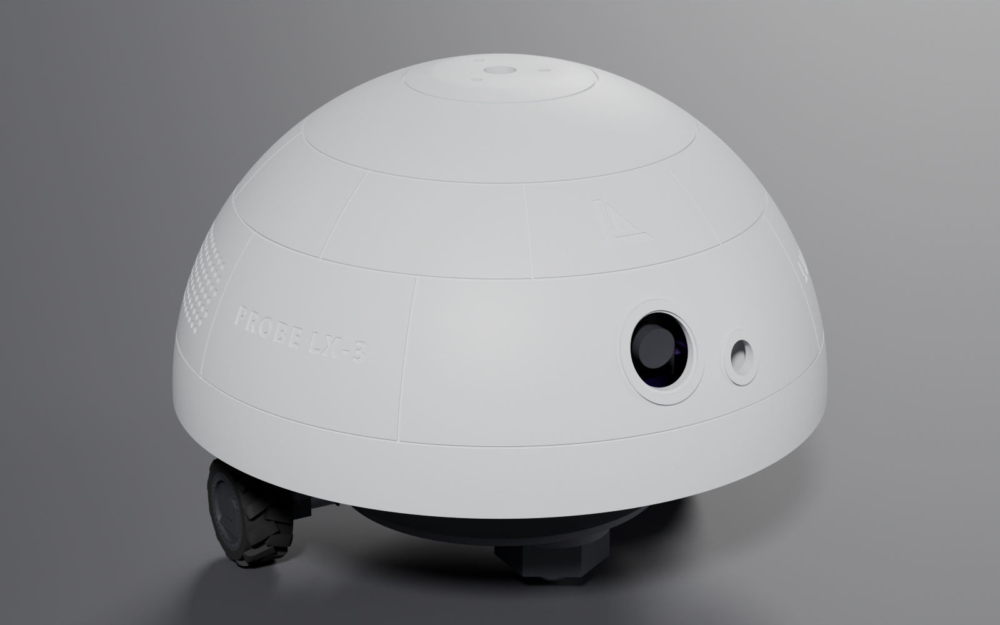
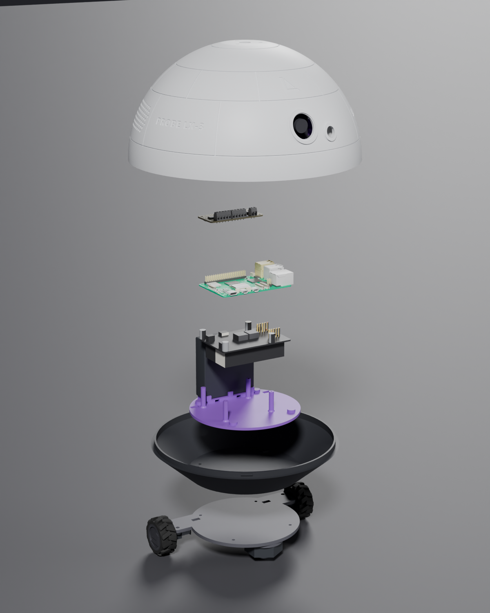
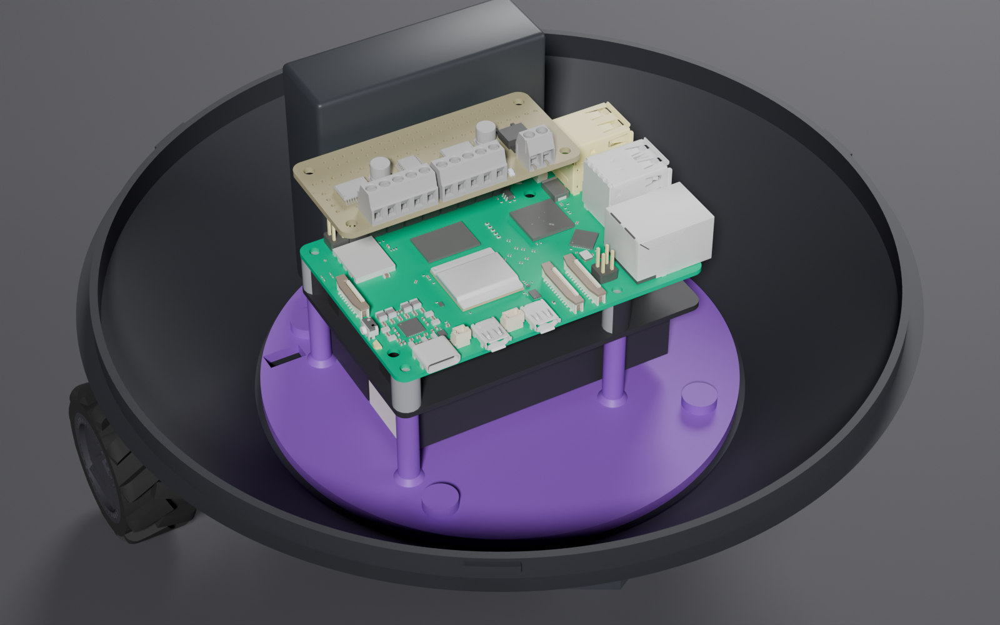
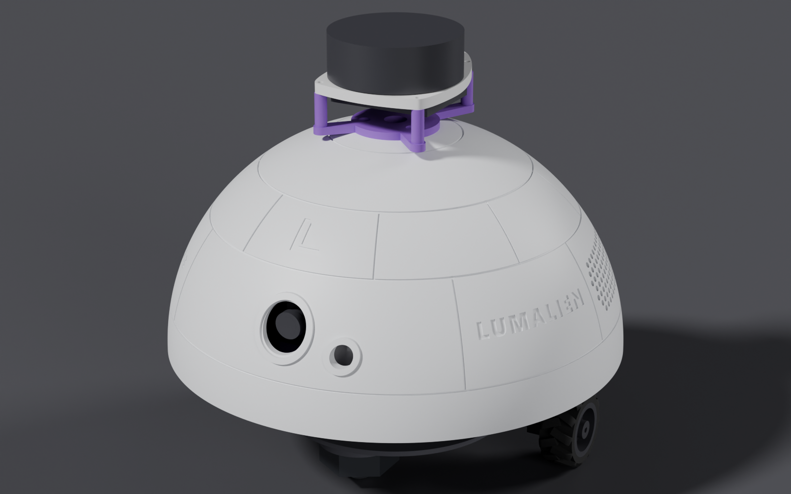
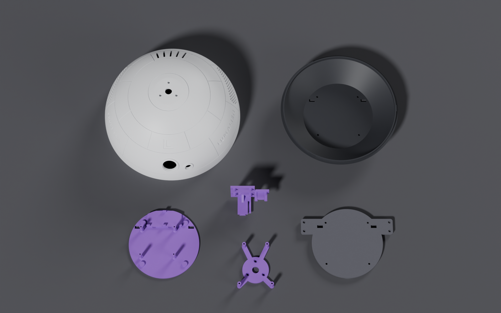

<div align="center">

# PROBE LX-3

**An open-source, 3D-printed Raspberry Pi 5 robot you build yourself.**<br>
A DIY rover with a camera, a distance sensor, a twist-lock dome and room for a lidar.

by [LUMALIEN](https://lumalien.com)




[**Parts list**](docs/BOM.md) · [**Printing**](docs/PRINTING.md) · [**Assembly**](docs/ASSEMBLY.md) · [**Wiring**](docs/WIRING.md) · [**Add-ons & upgrades**](docs/UPGRADES.md) · [**PDF manual**](manual/PROBE-LX-3-Assembly-Manual-v2.pdf)

**[⬇ Download the latest release (STLs + PDF manual)](https://github.com/patmakesapps/PROBE-LX-3/releases/latest)**

</div>

---

## What it is

PROBE LX-3 is a small differential-drive robot: a Ø245 mm dome on a Ø209 mm base, two N20 motors at the rear, and a ball caster up front. Inside is a Raspberry Pi 5 on a Geekworm X1200 UPS, an Adafruit motor bonnet, a USB camera and a VL53L1X distance sensor.

The dome twist-locks onto the base, so the electronics are one quarter-turn away. It's ready for a spinning lidar on top and a stereo speaker setup inside, with no reprints.

**This repo is hardware only.** No software ships with it. You get a robot with a camera, a range sensor, two drive motors and a Pi 5, and you write the software you need. [WIRING.md](docs/WIRING.md) lists every bus and address you'll need.

<table>
<tr>
<td width="50%"></td>
<td width="50%"><br><br></td>
</tr>
</table>

## Specs

| | |
| --- | --- |
| **Size** | Ø245 mm × ~186 mm tall (without lidar) |
| **Drive** | Differential, 2 × N20 gear motors (plain or encoder) + front ball caster |
| **Compute** | Raspberry Pi 5 (2 GB is enough) |
| **Power** | 2 × 18650 on a Geekworm X1200 UPS for the Pi · 4 × AA for the motors |
| **Sensors** | Arducam B0385 USB camera · CQRobot VL53L1X time-of-flight sensor |
| **Motor driver** | Adafruit 4280 DC + Stepper Motor Bonnet (I²C) |
| **Printed parts** | 7 core parts (including printed wheel hubs and TPU tyres) + 1 optional, all printed with no supports |
| **Printer** | 256 × 256 mm bed minimum (the dome is Ø244.8 mm). Designed on a Bambu Lab A1 |
| **Add-ons (no reprint)** | RPLIDAR A1M8 on top · Waveshare WM8960 audio HAT + 2 speakers |

## Build it in four steps

1. **Buy the parts.** Use the [Bill of Materials](docs/BOM.md) for electronics, motion parts, every screw and the tools.
2. **Print the parts.** Settings and orientations are in [PRINTING.md](docs/PRINTING.md), and the files are in [`stl/`](stl).
3. **Assemble.** Follow the [13-step assembly guide](docs/ASSEMBLY.md). It's about an afternoon's work.
4. **Wire it and check it.** [WIRING.md](docs/WIRING.md) has the connections and the pre-power checklist.

<p align="center"></p>

## Repository layout

```
PROBE-LX-3/
├── stl/                  Print-ready STL files (8)
├── cad/                  Full Blender source model (all parts + reference hardware)
├── docs/
│   ├── BOM.md            Everything you need to buy
│   ├── PRINTING.md       Print settings and orientation per part
│   ├── ASSEMBLY.md       Step-by-step build guide
│   ├── WIRING.md         Connections, I²C addresses, bring-up checklist
│   ├── UPGRADES.md       Lidar, audio, AI HAT+ 2, Jetson notes
│   └── images/           Renders
├── manual/               Original v2 assembly manual (PDF + Markdown)
└── tools/                Blender script that regenerates the renders
```

## Editing the design

`cad/PROBE-LX-3.blend` holds the whole assembly. It was made in Blender 5.0 with millimetre units. The printed parts are in the **PRINT PARTS** collection. Reference models of every bought component (Pi 5, X1200, bonnet, motors, caster, lidar, speakers and so on) sit in their own collections for fit checks. The **PRINT TOOLS (cutters)** collection holds the boolean cutters used to model the parts. It's hidden at render time.

To regenerate the README renders after a change:

```sh
blender -b cad/PROBE-LX-3.blend --python tools/render_images.py -- hero docs/images/hero.png 0.95 128
```

Views: `hero`, `hero_lidar`, `internals`, `exploded`, `parts`.

## Want a bigger robot?

PROBE LX-3 is LUMALIEN's free DIY robot. For a more capable robot, see the **[VISITOR LX-1 at lumalien.com](https://www.lumalien.com/visitor-lx-1)**.

## Contributing

Build logs, photos, remixes and fixes are welcome.

- **Built one?** [Show your build](https://github.com/patmakesapps/PROBE-LX-3/issues/new?template=show-your-build.yml). We love seeing them.
- **Stuck or found a problem?** [Ask for build help](https://github.com/patmakesapps/PROBE-LX-3/issues/new?template=build-help.yml).
- **Wrote software for it?** Share it through either link above and we'll list it here.

If this project helped you, give the repo a ⭐. It helps other makers find it.

## License

The design files, STLs, renders and docs are licensed under [Creative Commons Attribution-ShareAlike 4.0](LICENSE) (CC BY-SA 4.0). You can build, sell, modify and share it. Credit **LUMALIEN** and share your changes under the same license.

Product names (Raspberry Pi, Geekworm, Adafruit, Arducam, CQRobot, SLAMTEC RPLIDAR, Waveshare and others) belong to their owners and are used only to identify compatible parts.
