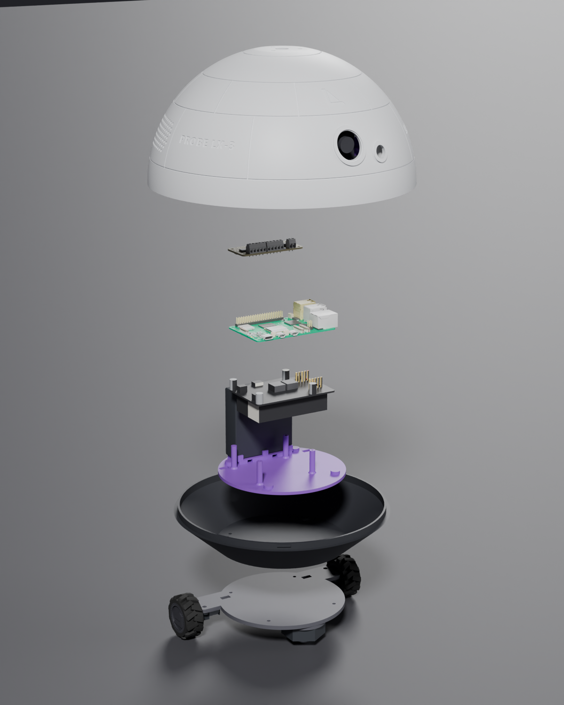
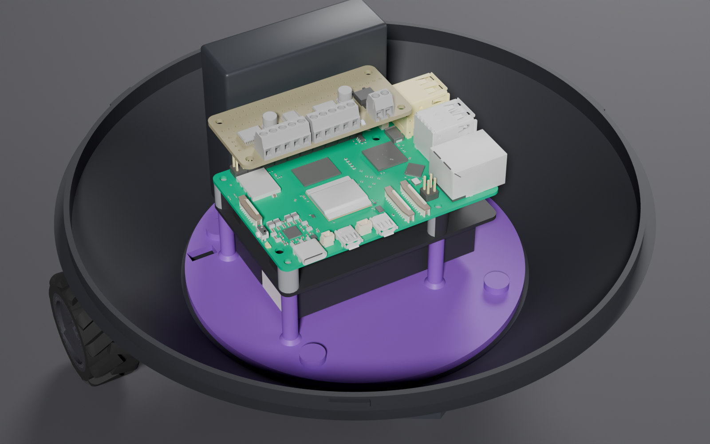
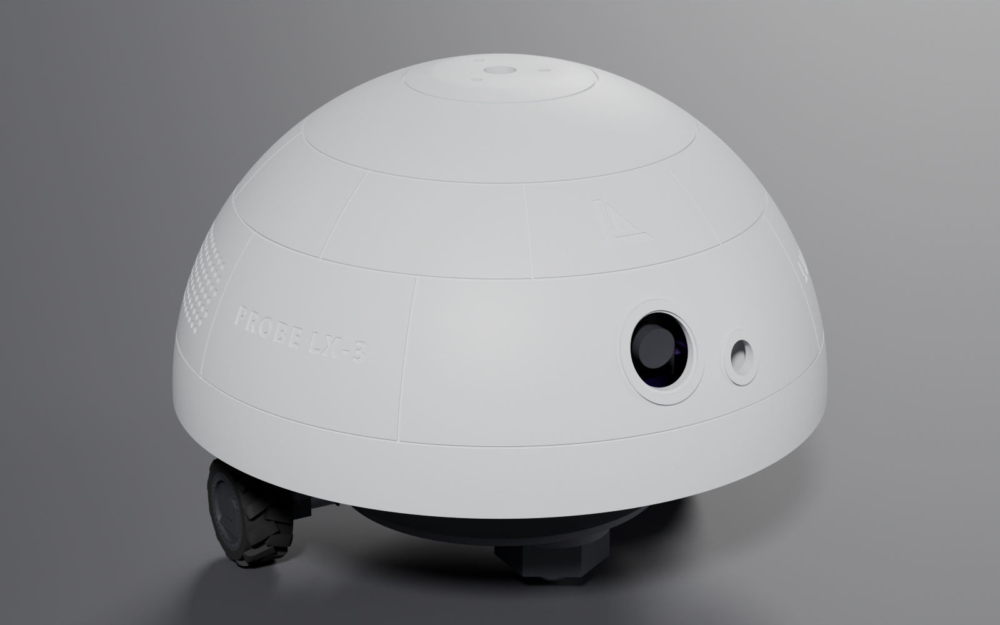

# Assembly Guide

[← Printing](PRINTING.md) · [README](../README.md) · Next: [Wiring →](WIRING.md)

The robot goes together bottom-up in **13 steps**. Build the drive plate first and fix it to the empty base. Then load the electronics, and fit the dome last.

**Directions used below:** **front** is the camera side. **Rear** is the battery-cradle side. **Left** and **right** are as the robot sees them.

**Before you start:** have everything from the [parts list](BOM.md) and all [printed parts](PRINTING.md) cleaned up.

## Contents

| Stage | Steps |
| --- | --- |
| **A. Shells and prep** | [1 Test-fit](#step-1--test-fit-the-shells) · [2 Inserts](#step-2--heat-set-inserts-in-the-electronics-tray) · [3 Nuts](#step-3--nuts-into-the-drive-plate) |
| **B. Drive plate** | [4 Motors](#step-4--mount-the-motors) · [5 Caster](#step-5--mount-the-caster) · [6 Motor wires](#step-6--route-the-motor-wires) |
| **C. Chassis** | [7 Plate + base + tray](#step-7--join-the-drive-plate-base-and-tray) |
| **D. Electronics** | [8 Pi 5 + X1200](#step-8--pi-5-and-x1200-stack) · [9 Motor bonnet](#step-9--motor-bonnet) · [10 AA pack](#step-10--4aa-battery-pack) · [11 Base wiring](#step-11--base-wiring) |
| **E. Dome** | [12 Camera + sensor](#step-12--camera-and-distance-sensor-into-the-dome) · [13 Connect and close](#step-13--connect-and-close) |
| **F. Verify** | [Checks before first power-on](#f-checks-before-first-power-on) |

---

## A. Shells and prep

### Step 1 — Test-fit the shells

1. Check that the dome's ledge, the three notches and the rail block's groove are clean and free of stringing.
2. Set the dome on the base with the camera about **30° counter-clockwise** of the front, seen from above. The notches drop over the base lugs.
3. Twist **clockwise** until it stops. It should turn freely through about 30° and stop hard at each end.

> Lift the dome off again. It goes back on in step 13.

### Step 2 — Heat-set inserts in the electronics tray

**You need:** 4 × M3×4×5 heat-set inserts, soldering iron with an insert tip

1. Turn the tray upside down on a towel.
2. Press an M3×4×5 insert into each of the **4 holes on the underside**, straight and flush.
3. Let them cool for a minute before loading them.

### Step 3 — Nuts into the drive plate

**You need:** 4 × M2 nuts, masking tape

1. Lay the plate **top face up**. That's the flat face, without the pad.
2. Press an M2 nut into each of the **4 hex pockets** on the arms. These hold the motor brackets.
3. Tape over all 4 pockets, then flip the plate so the raised caster pad faces up.

---

## B. Drive plate

### Step 4 — Mount the motors

**You need:** 2 × N20 motors with wheels, 2 × brackets, 4 × M2 screws

The motors ship with the wheels already on, so each one goes on as a unit.

1. Lay a motor on each **rear arm**, with the wheel pointing outward and the solder tabs (or encoder board) toward the centre.
2. Line the gearbox's front face up with the arm tip. The wheel should sit about **1 mm clear** of the tip.
3. *Encoder motors only:* the encoder board drops into the shallow pocket beside the wire slot.
4. Set a bracket over the gearbox with its two ears over the arm's two holes.
5. Drive 2 M2 screws through each bracket into the nuts. **Snug them only.** Overtightening crushes the gearbox.
6. Spin each wheel by hand. It must turn freely and not touch the plate.

### Step 5 — Mount the caster

**You need:** 1 × ball caster, isopropyl alcohol

1. Wipe the raised round pad clean with isopropyl alcohol if you have it.
2. Peel the caster's adhesive backing, centre the caster on the pad, and press hard for 30 seconds.
3. **Leave it 24 hours before driving** so the adhesive reaches full strength.
4. *Optional backup:* drive 2 short self-tapping screws through the caster's holes into the pad. Go **no deeper than 6 mm**, or they will reach the base floor.

### Step 6 — Route the motor wires

1. Feed each motor's wires up through the **10 × 5 mm slot** just inboard of that motor.
2. Remove the tape from the nut pockets.

---

## C. Chassis

### Step 7 — Join the drive plate, base and tray

**You need:** 4 × M3×10 button head, 2.0 mm hex key

One set of 4 screws clamps all three parts together.

1. Stand the drive plate on its wheels and caster.
2. Set the base on the plate, lining up its **4 small holes and 2 wire slots** with the plate's.
3. Drop the tray into the base with the posts up and the **battery cradle over the motors (rear)**. Feed the motor wires up through the tray's matching slots.
4. Tip the assembly onto its side.
5. Drive 4 M3×10 button screws **up** through the plate and base floor into the tray inserts.

---

## D. Electronics

### Step 8 — Pi 5 and X1200 stack

**You need:** Pi 5, X1200 (with its spacers and 4 × M2.5×20 screws), 2 × 18650 cells

1. **Fit both 18650 cells into the X1200 first.** The holders face down, and you can't reach them once the stack is in.
2. Set the Pi 5 on the X1200 with the spacers between them, so the pogo pins meet the pads on the Pi's underside.
3. Stand the stack on the 4 tray posts, with the **40-pin header toward the rear** and the **USB/Ethernet end toward the robot's left**.
4. Drive 4 M2.5×20 screws down through the Pi 5, spacers and X1200. The tips cut their own thread into the posts. **Stop at snug.**

### Step 9 — Motor bonnet

1. Press the motor bonnet straight down onto the Pi's 40-pin header.

> *Optional:* fit two ~8 mm M2.5 standoffs in the Pi's rear holes to support the bonnet.

### Step 10 — 4AA battery pack

**You need:** 4 × AA holder, 2 × zip ties (≥ 250 mm)

1. Stand the pack on its edge on the rear cradle, between the ribs.
2. Thread 2 zip ties through the tunnels under the cradle, up both faces of the pack, and over the top.
3. Put the tie heads on top of the pack, pull tight, and trim.

### Step 11 — Base wiring

**You need:** small flat screwdriver

1. **Left motor → bonnet terminal M1. Right motor → M2.** If a wheel runs backward in testing, swap that motor's two wires.
2. 4AA pack leads → the bonnet's **motor power** terminal, **red to +**. Leave the pack switched off, or leave a cell out.

See [WIRING.md](WIRING.md) for the full diagram.

---

## E. Dome

### Step 12 — Camera and distance sensor into the dome

**You need:** camera bracket, Arducam B0385, VL53L1X, 4 × M2×8 socket pan, 2 × M2×5 button, 2 × M3×10 button

Load the bracket on the bench first, then slide it into the dome.

1. **Camera:** with the lens facing away from the bracket, set the board on the **4 short standoffs**. Gently drive 4 M2×8 socket pan screws through the board into the standoffs. Plug the camera cable in through the window in the bracket plate.
2. **Distance sensor:** plug its cable in first, with the connector facing down. Set the board on the **2 long standoffs** with the chip facing away from the bracket, and fix it with 2 **M2×5** button screws.
3. Set the dome upside down on a towel. Find the **rail block** on the ledge below the camera opening.
4. Hold the bracket with the lens toward the opening. Drop the dovetail key into the open end of the groove and push the bracket toward the wall.
5. The latch rides up over the block and **clicks** into its notch as the key hits the end stop. The lens now sits in the Ø24 opening, and the sensor chip faces its window.
6. On the dome's rim face below the camera, find the **two recessed holes**. Drive 2 M3×10 button screws up through them into the bracket key until snug. The heads sit below the rim face, so the dome still seats on the base.
7. **To remove the bracket:** take out the 2 screws, push the latch arm up (toward the dome top) where it passes the end of the block, and slide the bracket back out.
8. Route both cables down toward the base with **at least 70 mm of slack**. They must reach the Pi with the dome unlocked.

### Step 13 — Connect and close

1. Camera USB lead → any Pi USB port.
2. Distance sensor → the Pi's I²C pins: **3.3 V, GND, SDA (GPIO2), SCL (GPIO3)**. Reach them through the bonnet's pass-through pads or a stacking header. The sensor (0x29) and the bonnet (0x60) use different I²C addresses.
3. Tuck the cables so nothing crosses the base lugs.
4. Set the dome on about 30° counter-clockwise, then **twist clockwise to the stop**. The camera now faces the front, over the caster.
5. **To open:** twist counter-clockwise to the stop and lift.

---

## F. Checks before first power-on

Run these with the robot on the bench before its first drive.

- [ ] Both wheels and the caster touch the table, and the robot sits level.
- [ ] The wheels spin freely by hand, about 1 mm clear of the plate arms.
- [ ] The robot doesn't tip backward when rocked. The caster stays loaded.
- [ ] The dome twists through its full 30° both ways with all cables connected and no pull on the plugs.
- [ ] The 4AA leads are on the bonnet's motor power terminal with correct polarity **before** the last cell goes in.
- [ ] The 18650 cells are charged, and the Pi boots from the X1200 alone.
- [ ] `lsusb` shows the camera, and `i2cdetect -y 1` shows **0x29** (distance sensor) and **0x60** (bonnet).
- [ ] Each wheel turns forward on a forward command. If one doesn't, swap that motor's two wires at the bonnet.
- [ ] *Audio add-on only:* `i2cdetect -y 1` also shows **0x1a** (WM8960), and both speakers play.

**You're done.** Now write some software. [WIRING.md](WIRING.md#writing-your-own-software) lists what each device needs.

---

[← Printing](PRINTING.md) · [README](../README.md) · Next: [Wiring →](WIRING.md)
