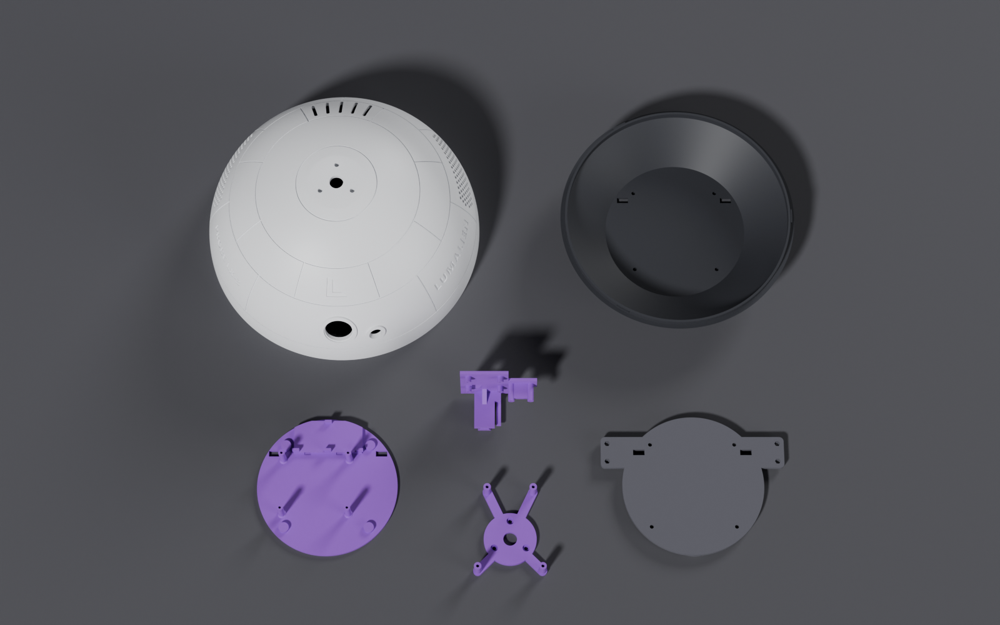

# Printing Guide

[← Parts list](BOM.md) · [README](../README.md) · Next: [Assembly →](ASSEMBLY.md)

Every part is sized for a **Bambu Lab A1 (256 mm bed)**, has **3.0 mm design walls**, and prints with **no supports**.

## Parts

| File | Part | Size (mm) | Orientation on the bed | Notes |
| --- | --- | --- | --- | --- |
| [`PROBE-LX3_dome.stl`](../stl/PROBE-LX3_dome.stl) | Dome | Ø244.8 × 120 | **Rim down** | Leaves 5.6 mm per side on a 256 mm bed. The inside of the top bridges about 45 mm. A little sag there is hidden. |
| [`PROBE-LX3_base.stl`](../stl/PROBE-LX3_base.stl) | Base | Ø209.4 × 41.5 | **Floor down** | Plain shell with 49° walls. |
| [`PROBE-LX3_electronics-tray.stl`](../stl/PROBE-LX3_electronics-tray.stl) | Electronics tray | Ø123 × 26 | **Underside down** | Carries the Pi 5 posts and the 4AA cradle. For electronics changes, reprint this part, not the base. |
| [`PROBE-LX3_drive-plate.stl`](../stl/PROBE-LX3_drive-plate.stl) | Drive plate | 161 × 124 × 7.5 | **Top face down** | Nut pockets face the bed and the caster pad faces up. |
| [`PROBE-LX3_camera-bracket.stl`](../stl/PROBE-LX3_camera-bracket.stl) | Camera bracket | 67 × 61 × 35.6 | **Flat back face down** | Holds the camera and distance sensor, and clicks into the dome's rail. |
| [`PROBE-LX3_lidar-adapter_optional.stl`](../stl/PROBE-LX3_lidar-adapter_optional.stl) | Lidar adapter *(optional)* | 64 × 78 × 21.7 | **Flat face down** | Only for the RPLIDAR add-on. |

## Suggested slicer settings

These are starting points. Tune them for your printer and filament.

| Setting | Value |
| --- | --- |
| Material | PLA or PETG |
| Layer height | 0.2 mm (0.16 mm on the camera bracket for a crisper latch) |
| Wall loops | Enough to fill the 3 mm design walls (about 4–5 at 0.4 mm line width) |
| Infill | 15–20 % (gyroid or grid) |
| Supports | **Off**. No part needs them. |
| Brim | Optional on the dome and base, if your bed adhesion is marginal |

> **Printing on a smaller bed?** The dome needs at least a 245 mm circle. Everything else fits a 220 mm bed.

## After printing

- [ ] Clear every hole: the insert holes, pilot holes, and screw holes through the plate and base.
- [ ] Push a zip tie through each **speaker loop** inside the dome to clear it, even if you aren't fitting audio yet.
- [ ] Check the dome's **ledge, the three bayonet notches and the rail block's groove** for stringing.
- [ ] Test-fit the dome on the base (see [Assembly step 1](ASSEMBLY.md#step-1--test-fit-the-shells)).

---

[← Parts list](BOM.md) · [README](../README.md) · Next: [Assembly →](ASSEMBLY.md)
