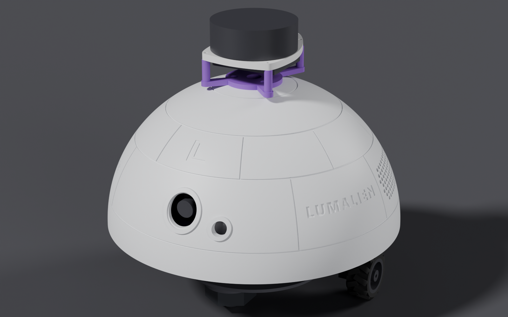

# Add-ons & Upgrades

[← Wiring](WIRING.md) · [README](../README.md)

The dome already has the mounting holes, grilles and zip-tie loops for both add-ons below, so **neither one needs a reprint**. Parts lists are in the [BOM](BOM.md#optional-add-ons).

---

## Lidar: SLAMTEC RPLIDAR A1M8

<p align="center"></p>

**Needs:** printed lidar adapter, 3 × M3×4×5 inserts, 3 × M3×6 button head, 4 × M2.5 screws

| Joint | Fastener | Qty | Goes into |
| --- | --- | :-: | --- |
| Adapter → dome | M3×4×5 heat-set insert | 3 | Ø4.2 × 5.5 mm holes in the dome's flat top |
| Adapter → dome | M3×6 button head | 3 | Adapter counterbores into the inserts |
| Lidar → adapter | M2.5 screw | 4 | Ø2.7 holes through the adapter posts |

1. Press 3 M3×4×5 inserts into the 3 small holes on the dome's flat top, flush.
2. Fix the lidar to the adapter posts with **its motor toward the rear**, using 4 M2.5 screws.
3. Feed the lidar cable through the adapter's centre hole and the dome's Ø12 centre hole.
4. Seat the adapter on the dome's flat top and fix it with 3 M3×6 button screws.
5. Plug the cable into a Pi USB port through the lidar's adapter board. Leave slack for the 30° dome twist.

> The lidar adds about **170 g** at the top. Keep acceleration and braking gentle in software.

---

## Audio: Waveshare WM8960 Audio HAT

**Needs:** WM8960 Audio HAT (with built-in mics), 2 × Waveshare 8 Ω 5 W speakers (100 × 45 × 21 mm), 11 mm M2.5 standoffs, 4 × zip ties (≥ 150 mm)

| Joint | Fastener | Qty | Goes into |
| --- | --- | :-: | --- |
| Motor bonnet → audio HAT | M2.5 brass standoff, 11 mm | 1 per bonnet mounting hole | Between the two boards, so they can't touch |
| Speakers → dome | Zip tie, 4.8 mm wide, ≥ 150 mm | 4 | Through the loops above and below each speaker end |

1. Lift the motor bonnet off the Pi.
2. Press the audio HAT onto the Pi's 40-pin header.
3. Fit the 11 mm standoffs on the HAT. Then press the motor bonnet onto the pins that come up through the HAT and fix it to the standoffs. The pins must stand **at least 7.5 mm above the HAT board**. If they don't, add a 2×20 stacking header.
4. With the dome upside down, set each speaker face-down over its grille (the two hole fields on the rear half of the dome), long side horizontal.
5. At each end of a speaker, thread a zip tie through the lower loop, up between the speaker end and the wall, through the upper loop, and around the back of the speaker's stepped end. Pull snug and trim.
6. Route the speaker leads to the HAT's speaker connector with enough slack for the 30° dome twist.

**Check:** `i2cdetect -y 1` shows `0x1a`, and both speakers play.

---

## Raspberry Pi AI HAT+ 2 (Hailo-10H, 8 GB): fits, no reprint

The AI HAT+ 2 runs small language models (1–1.5B parameters, such as Qwen2/2.5 1.5B, Llama 3.2 1B and DeepSeek-R1-Distill 1.5B) through an Ollama-compatible server, in its **own 8 GB of RAM**. That makes it a good match for a 2 GB Pi 5.

Expect about the same speed as running the model on the Pi's CPU. The gain is freed-up Pi memory, and running vision and a language model at the same time. The HAT draws up to 3 W, which shortens battery time.

**Stack, bottom to top:**

```
Motor bonnet
Audio HAT            (optional)
AI HAT+ 2            (PCIe ribbon, on its standoffs)
Pi 5 + Active Cooler
X1200 UPS
```

The Hailo chip uses PCIe, not GPIO, so nothing clashes, and the I²C addresses stay unique (bonnet 0x60/0x70, audio 0x1a, distance sensor 0x29). The dome has plenty of height for the extra layer.

Check that the 40-pin header passes up through the AI HAT, and add a 2×20 stacking header if it doesn't. Watch temperatures with the full stack inside the closed dome.

> The original **AI HAT+ (Hailo-8 / 8L)** is for vision only. It can't run language models.

---

## NVIDIA Jetson Orin Nano: not a drop-in swap

- The dev kit (about 103 × 90.5 mm) is **larger than the Pi 5** and won't fit the tray's post pattern or diameter.
- The X1200 is **Pi 5-only** (5 V through pogo pins). The Orin Nano needs about **9–20 V at up to 25 W**.
- The motor bonnet should work over the Orin's I²C header pins, but it may not stack past the heatsink.
- The WM8960 audio HAT needs driver and device-tree work on JetPack.

**What carries over:** the dome, base, drive plate, camera bracket and speakers. **What needs a redesign:** the electronics tray and the power system. Remix PRs are welcome.

---

[← Wiring](WIRING.md) · [README](../README.md)
