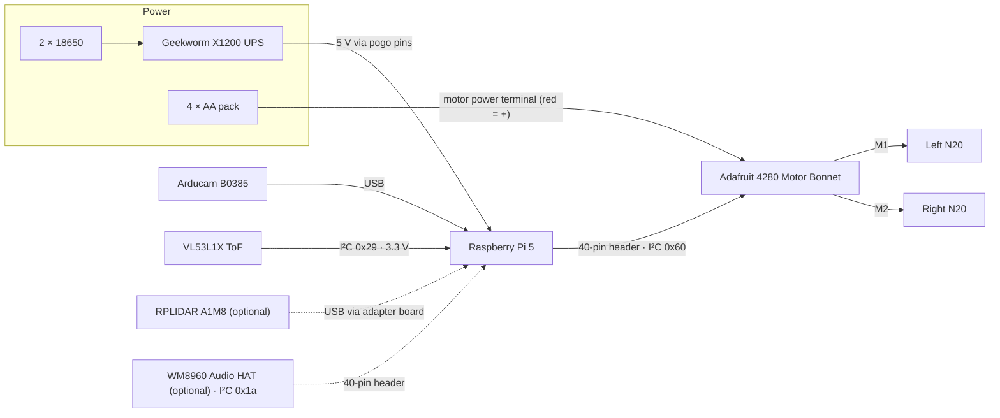

# Wiring

[← Assembly](ASSEMBLY.md) · [README](../README.md) · Next: [Add-ons & upgrades →](UPGRADES.md)

## System diagram



## Connection table

| From | To | Notes |
| --- | --- | --- |
| X1200 | Pi 5 | Pogo pins to the pads on the Pi's underside. No wires. |
| Motor bonnet | Pi 5 | Pressed onto the 40-pin header |
| Left N20 motor | Bonnet **M1** | If the wheel runs backward, swap the two wires |
| Right N20 motor | Bonnet **M2** | Same as the left motor |
| 4 × AA pack | Bonnet **motor power** terminal | **Red to +.** This powers the motors only, not the Pi. |
| Arducam B0385 | Any Pi USB port | |
| VL53L1X **VIN** | Pi **3.3 V** (pin 1) | Through the bonnet's pass-through pads or a stacking header |
| VL53L1X **GND** | Pi **GND** (pin 6) | |
| VL53L1X **SDA** | Pi **GPIO2 / SDA** (pin 3) | |
| VL53L1X **SCL** | Pi **GPIO3 / SCL** (pin 5) | |

**Cable slack:** leave at least **70 mm** on every cable that runs from the dome to the base. The dome twists 30° to unlock, and nothing should pull on a plug.

## I²C address map (bus 1)

| Address | Device | Present |
| :-: | --- | --- |
| `0x1a` | WM8960 audio codec | Audio add-on only |
| `0x29` | VL53L1X distance sensor | Always |
| `0x60` | Motor bonnet (PCA9685 PWM) | Always |
| `0x70` | Motor bonnet all-call address | Always |

Every address is unique, so nothing clashes, even with the audio add-on and an AI HAT+ 2 (which uses PCIe, not GPIO).

Check them with:

```sh
i2cdetect -y 1
```

---

## Writing your own software

PROBE LX-3 ships with **no software**. Use whatever language or framework you like. Here's what each device needs from the Pi:

| Device | Interface | Where to start |
| --- | --- | --- |
| **Drive motors** (via the Adafruit 4280 bonnet) | I²C `0x60` | Adafruit's [DC & Stepper Motor Bonnet guide](https://learn.adafruit.com/adafruit-dc-and-stepper-motor-hat-for-raspberry-pi) and the `adafruit-circuitpython-motorkit` library. M1 is the left motor and M2 is the right. |
| **Camera** (Arducam B0385) | USB (UVC) | Appears as `/dev/video*`. Use OpenCV, GStreamer, ffmpeg, or any V4L2 tool. |
| **Distance sensor** (VL53L1X) | I²C `0x29` | Any VL53L1X driver. It points forward, next to the camera. |
| **UPS / battery** (X1200) | See Geekworm's docs | Geekworm's X1200 wiki covers battery-level and power-loss monitoring. |
| **Lidar** (RPLIDAR A1M8, optional) | USB serial | SLAMTEC's SDK, or the `rplidar_ros` package for ROS 2. The lidar motor faces the rear. |
| **Audio** (WM8960 HAT, optional) | I²S + I²C `0x1a` | Waveshare's WM8960 HAT driver. It includes microphones for voice. |

**Some ideas:** teleop over Wi-Fi, obstacle avoidance with the ToF sensor, follow-me with camera vision, SLAM mapping with the lidar, or a voice assistant with the audio HAT and an [AI HAT+ 2](UPGRADES.md).

> The lidar adds about 170 g at the top of the dome. If you fit it, keep acceleration and braking gentle in your software.

Built something? Open an issue with a link and we'll add it to the README.

---

[← Assembly](ASSEMBLY.md) · [README](../README.md) · Next: [Add-ons & upgrades →](UPGRADES.md)
